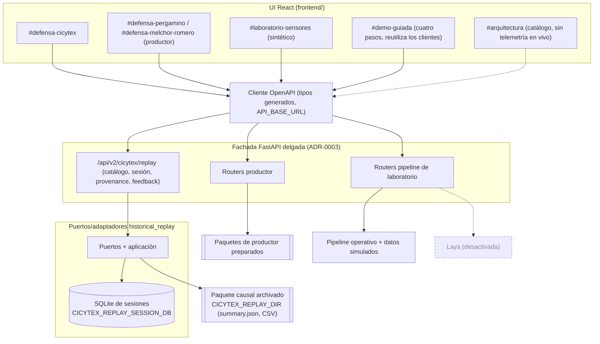

# F8 - Paquete de defensa de la UI de arquitectura (HU6, `alerting-ui`)

Fase CRISP-DM: despliegue/comunicación. Sin impacto sobre configuración experimental,
hipótesis, alcance ni arquitectura. La UI es apoyo a la decisión; no automatiza riego.
Convención: «no verificado» = no comprobado en esta redacción.

## 1. Guion de demo (3-5 min)

Guion detallado con datos identificados, plan B con fixtures y ensayo técnico cronometrado:
`docs/design/demo-guion-defensa.md`. El ensayo humano con quien defiende está pendiente (no bloquea tareas técnicas).

Previo (fuera de tiempo): backend CICYTEX y frontend arriba (sección 5), navegador en `#resumen`.

**Alternativa simplificada para el video:** `#demo-guiada` (PR #69) recorre en cuatro pasos CICYTEX, Pergamino, Melchor Romero y el
laboratorio, con un caso fijo por sitio, sin feedback ni Laya. No reemplaza la tabla siguiente, que usa las vistas detalladas. Detalle
del recorrido en la sección 3.1 de `docs/design/demo-guion-defensa.md` y requisitos de datos por paso en la sección 0.1 de
`docs/design/defense-demo-startup-guide.md`. Su ensayo humano y su ejecución contra el backend real están pendientes.

| # | Tiempo | Ruta | Mostrar | Decir |
| --- | --- | --- | --- | --- |
| 1 | 0:00-0:30 | `#arquitectura` | Mapa por nodos, insignia de modo por vista, ficha de Laya («Desactivado por defecto»). | «Esta es la arquitectura final. Los datos IoT son una fuente, no la contribución; el núcleo es el modelado. Laya existe pero está desactivada y no hay telemetría en vivo.» |
| 2 | 0:30-1:00 | `#defensa-cicytex` | Selectores de sensor/horizonte/emisión. Sin sesión no hay «Día siguiente» ni feedback. | «Es una reproducción histórica causal: el paquete está archivado y congelado.» |
| 3 | 1:00-1:40 | `#defensa-cicytex` | «Abrir emisión congelada» (por defecto CP1_S1, h=1, 2023-07-06); mostrar la decisión (alerta / sin alerta de humedad baja). | «El sistema decide solo con lo observado hasta la emisión. Es apoyo a la decisión.» |
| 4 | 1:40-2:20 | misma | Panel de trazabilidad: fuente, emisión, objetivo, modelos congelados, identidad del paquete (hash y commit completos). Señalar que versión de modelo y linaje de recalibración figuran como no disponibles. | «Cada predicción se rastrea al paquete archivado; lo que no tenemos lo declaramos, no lo inventamos.» |
| 5 | 2:20-3:00 | misma | «Día siguiente»: avanza el reloj; el gráfico revela solo lecturas hasta el reloj. | «El futuro no está en el payload mostrado; no hay fuga temporal en la vista.» |
| 6 | 3:00-3:40 | misma | Realidad revelada: comparación contra P20 y comparación acumulada de métodos. | «Ahora que la realidad se reveló comparamos. Es un recorrido, no una campaña de evaluación.» |
| 7 | 3:40-4:20 | misma | Feedback humano habilitado solo con realidad revelada; enviarlo; cambiar de sensor/reiniciar y mostrar borrador limpio. | «El feedback queda aislado por sesión y no se filtra a otra.» |
| 8 | 4:20-5:00 | `#defensa-pergamino`, `#defensa-melchor-romero`, `#laboratorio-sensores` (opcional) | Los otros sitios (recorrido histórico compartido: veredicto, acciones, trazabilidad declarada, campo «Recorrido hasta») y el laboratorio sintético (insignia de modo distinta; jerarquía de acciones, nota de paso deshabilitado, trazabilidad sintética). El laboratorio tiene pendientes declarados (ver sección 6). | «Pergamino y Melchor Romero comparten un recorrido histórico con trazabilidad del payload de `producer_v2` (sin SHA-256 de dataset, commit ni MLflow: se declaran no disponibles); el laboratorio es sintético, con procedencia sintética declarada y sin valor de evidencia científica.» |

Si falla el backend en vivo: mostrar el error con reintento (sección 4) y las capturas
`docs/design/capturas/f7-cicytex-*.png`.

## 2. Arquitectura final

Tres dominios separados: CICYTEX (paquete causal archivado), productor (Pergamino/Melchor
Romero) y laboratorio (sintético). La flecha a Laya está punteada: integrada pero apagada
(ADR-0014). El diagrama es una síntesis: el detalle por nodo vive en el catálogo de `#arquitectura`.

## 3. Mapa antes/después (PRs #45-#67 y #69; #68 es el cierre documental `9f246fb`)

| PR | Estado | Qué cambió en la UI |
| --- | --- | --- |
| #45 | merged | Checkpoint F0-F1 y diseño F3 (docs): inventario y plan de la UI de arquitectura y defensa. |
| #46 | merged | F4: destino «Arquitectura» e indicador de modo por vista. |
| #47 | merged | F6: catálogo de arquitectura con fichas por nodo. |
| #48 | merged | F5: robustez operativa del recorrido CICYTEX (primer sitio). |
| #49 | merged | Docs: checkpoint tras F4, F5 y F6. |
| #50 | merged | F7 parcial: pruebas de resiliencia sin backend, Laya apagada y teclado. |
| #51 | merged | Aislamiento del borrador de feedback CICYTEX por sesión. |
| #52 | merged | Recorrido visual integral de CICYTEX. |
| #53 | merged (`a4a6ba4`) | F6: trazabilidad de una predicción concreta en CICYTEX (endpoint `provenance` de solo lectura, 503 si el paquete no cumple el contrato). |
| #54 | merged (`b665c8d`) | Docs: verificación en navegador real del recorrido CICYTEX y primera versión de este paquete (F7/F8). |
| #55 | merged (`696154f`) | F5/F6: recorrido histórico compartido por Pergamino y Melchor Romero: veredicto, acciones primaria/secundaria, trazabilidad declarada (lo que `producer_v2` no expone figura «no disponible») y filtro cliente de observaciones futuras. |
| #56 | merged (`653e4a7`) | F5: campo «Recorrido hasta» con el reloj efectivo desde el inicio (borrador local; descarta un borrador obsoleto cuando cambia el reloj efectivo). |
| #57 | merged (`43bdfb3`) | F5/F6: laboratorio de sensores con jerarquía de acciones, nota de paso deshabilitado y trazabilidad sintética declarada (semilla, reloj ficticio, datos sintéticos). |
| #58 | merged (`73a1cfc`) | Docs: ADR 0015, paquete de defensa y tracking F5-F8. |
| #59 | merged (`a433b4d`) | F5: recuperación de la sesión CICYTEX al recargar (`sessionStorage` + `GET /sessions/{id}`; con 404, aviso `role="alert"` e «Iniciar otra emisión»; el borrador no se transfiere) y feedback sin preselección. |
| #60 | merged (`e575a30`) | F5: «Confirmar» y «Rechazar» con el mismo peso visual (clase `forecast-card-choice`), sin preselección y con envío único. |
| #61 | merged (`c7e13b8`) | F5: laboratorio: nota «Cómo revisar» corregida, una sola línea de «no disponible» y recorrido visual a 360 px de A a D. |
| #62 | merged (`9cea43f`) | F7: recorridos de navegador de cuatro sitios y la ficha de Laya con fixtures deterministas, y job `browser-journeys` en CI. |
| #63 | merged (`f43c3b4`) | Docs: sincroniza ADR 0015, F7/F8 y seguimiento con #59-#62. |
| #64 | merged (`584bd94`) | HU6, `predictive-modeling`: `bundle.json` de las ejecuciones nuevas registra `code_identity` (commit/dirty). |
| #65 | merged (`c5dc55e`) | F8: guion de demo de 3-5 min y ensayo técnico cronometrado (`docs/design/demo-guion-defensa.md`, `scripts/ui/rehearse-demo.mjs`; 22 PASS en tres corridas). |
| #66 | merged (`6106b78`) | F5: laboratorio con objetivos táctiles de 44 px por regla CSS a ≤600 px (no medido en navegador), mensaje de red en español y test con backend apagado; regresión de la redacción de Laya. |
| #67 | merged (`5e22733`) | F6: endpoint de solo lectura de procedencia de la emisión y panel «Procedencia de la emisión» (emisiones previas a #64: «no registrado»; configuración, MLflow y semilla: «no disponible»). |
| #69 | merged (`d173215`) | HU6, `alerting-ui`: recorrido guiado `#demo-guiada` de cuatro sitios (commits `77e6ea8` y `b775db1`). Reutiliza endpoints existentes, no ofrece feedback ni muestra Laya y suma el sitio `demo-guiada` a `verify-journeys.mjs`. |

Antes: vistas sin separación explícita de modo, sin mapa de arquitectura, recorrido CICYTEX
frágil ante fallos y sin rediseño ni trazabilidad en los demás sitios. Después: modo visible,
catálogo navegable por teclado y, en los cuatro sitios, recorrido rediseñado con trazabilidad
declarada, con la salvedad de los datos disponibles en cada uno: CICYTEX (identidad del
paquete: hash y commit; versión de modelo y linaje de recalibración no disponibles),
Pergamino y Melchor Romero (payload de `producer_v2`; desde #67, panel de procedencia con SHA-256 del dataset, `model_version`, calibración, `trained_through` y `code_identity` cuando el bundle la registró; «no registrado» en emisiones previas a #64 y «no disponible» para configuración, MLflow y semilla) y laboratorio (procedencia sintética: semilla y
reloj ficticio; no es evidencia científica). Los títulos y los merge commits provienen de
`gh pr view`; el detalle por PR no se releyó aquí.

## 4. Matriz de robustez

Evidencia: `App.resilience.test.tsx` (AR), `CicytexDefensePage.test.tsx` (CP),
`backend/tests/test_cicytex_replay_provenance.py` (BP), `scripts/ui/verify-journeys.mjs`
(NAV). Resultado contra fixtures deterministas: 78 PASS en #62 y 80 PASS, 0 FAIL y 1 INFO con #67 (corridas históricas, anteriores a #69; A9: rutas sin fixture
`GET /api/v2/sectors` y `/api/v2/sensors`), en cuatro sitios y la ficha de Laya. Con #69 se suma el sitio `demo-guiada`: `EXPECTED_MIN_CHECKS` exige 23 chequeos para él y 104 en total (103 PASS más 1 INFO esperables), cifra derivada del script y no ejecutada en esta redacción. El detalle por sitio está en
`docs/design/f7-verificacion-navegador.md`. Los resultados históricos de la primera versión (CICYTEX, 12 `ok: true` y
J6 informativo) siguen en `docs/design/capturas/f7-verificacion-navegador.json`. Se suman las pruebas de componente de
#55-#60 y la verificación visual de la sección 6.

| Escenario | Comportamiento | Evidencia | Nivel |
| --- | --- | --- | --- |
| Backend desconectado (app general) | La app sigue renderizando encabezados y la insignia de modo; las llamadas se rechazan realmente. | AR (`App con backend desconectado`) | Componente |
| Backend desconectado durante el recorrido | Mensaje `role=alert`, botón vuelve a habilitarse; al volver la red el reloj avanza (2023-07-06 → 2023-07-07) y el error desaparece. | NAV J3, J3b, J4 | Navegador real |
| Catálogo caído | Reintento ofrecido; se recupera al éxito; estado de carga hasta que llega. | CP (`offers a retry...`, `shows a loading state...`) | Componente |
| Catálogo caído en navegador | No verificado (NAV solo comprueba el catálogo cargado, J0). | - | No verificado |
| Respuesta tardía/obsoleta | Se ignora una sesión tardía tras cambiar la selección; una respuesta de feedback tardía no se aplica a otra sesión; doble envío envía una sola vez. | CP (`ignores a late session...`, `does not apply a late feedback...`, `submits feedback once...`) | Componente |
| Paquete causal ausente/corrupto | `provenance` responde 503 si falta `summary.json` o no cumple el contrato; la UI mantiene el recorrido y lo dice; horizonte ausente → «no disponible». | BP; CP (`keeps the journey usable...`, `says the horizon is unavailable...`) | Componente/API (el 503 en navegador: no verificado) |
| Laya desactivada | Ficha «Desactivado por defecto»; aviso «no es monitoreo en vivo». | AR | Componente |
| Teclado | Enter/Espacio activan nodos; foco recorre 7 paradas distintas sin trampa, con indicador visible; selectores antes de «Abrir». | AR; NAV J7, J7b, J7c | Componente + navegador real |
| Recarga (CICYTEX) | Se conserva la ruta y la sesión se restaura por `sessionStorage` + `GET /sessions/{id}` con el mismo reloj; si falla la recuperación (por ejemplo 404, registro mal formado o sesión que no coincide) se muestra el aviso `role="alert"`, se borra la referencia y se ofrece «Iniciar otra emisión» (el script ejercita el 404). El borrador de feedback no se transfiere; la recuperación es por pestaña. | `CicytexDefensePage.restore.test.tsx` (componente); NAV C7, C10, C10b (#62, fixtures) | Componente + navegador real (fixtures) |
| Permisos por estado | Sin sesión no hay «Día siguiente» ni feedback; con realidad oculta no hay feedback; realidad revelada lo habilita; «Día siguiente» deshabilitado sin más días con explicación. | NAV J1, J2b, J5; CP (`explains why the primary action is disabled...`) | Componente + navegador real |
| Lecturas futuras | Nunca se dibujan ni mencionan lecturas posteriores al reloj, aunque el payload las traiga. | CP (`never draws or mentions readings...`) | Componente |
| Observaciones futuras (Pergamino/Melchor Romero) | El cliente filtra filas posteriores al reloj del recorrido. | Pruebas de componente de #55 (no releídas en esta redacción) | Componente |
| Campo «Recorrido hasta» | Muestra el reloj efectivo desde el inicio; descarta un borrador local obsoleto al cambiar el reloj efectivo. | Pruebas de componente de #56 (no releídas en esta redacción) | Componente |
| Pergamino y Melchor Romero a 1366 y 360 px | Sin desbordes de página y sin texto fijo de Pergamino en Melchor Romero. | Chrome headless contra backend real; capturas en el scratchpad, no versionadas | Verificación visual puntual, no repetible desde el repo |
| Laboratorio de sensores | Recorrido visual a 360 px de A a D declarado en #61; el script de navegador (#62) cubre A y B, no C ni D. Pendientes declarados: tamaños táctiles (selectores 36 px, `summary` 21 px, enlace 20 px), mensaje crudo en inglés «Failed to fetch» y laboratorio con backend apagado sin probar. | Verificación visual de #61; NAV (laboratorio, 12 chequeos) | Parcial |
| Acciones de revisión equivalentes | «Confirmar» y «Rechazar» comparten clase `forecast-card-choice`, sin preselección y envío único. | `ForecastCard.reviewActions.test.tsx` | Componente (el script de navegador no lo comprueba) |
| Accesibilidad automatizada (axe) | No se ejecuta. | - | No verificado |

## 5. Arranque y recuperación

Pasos generales (puertos, preparación de artefactos, `start_defense_demo.ps1`):
`docs/design/defense-demo-startup-guide.md`. Solo lo específico de CICYTEX:

- `CICYTEX_REPLAY_DIR`: directorio del paquete causal (catálogo, `summary.json`). Por defecto
  `results/cicytex/causal_replay` del repositorio. Sin él, catálogo y provenance responden 503.
- `CICYTEX_REPLAY_SESSION_DB`: SQLite de sesiones durables. Por defecto
  `cicytex_replay_sessions.sqlite3` bajo el directorio de datos del backend.
- Frontend: la base de API general sale de `VITE_API_BASE_URL` (por defecto `http://localhost:8000` en `api/baseUrl.ts`). El cliente de CICYTEX
  (`features/defense/cicytexApi.ts`) usa el mismo origen cuando la variable no está definida, y la imagen de `compose.cicytex.yml` la fija vacía.
  El proxy de `/api` hacia `http://127.0.0.1:8010` existe solo en `frontend/vite.verify.config.mjs`
  (archivo versionado desde #54, puerto 5199), usado por `scripts/ui/verify-journeys.mjs`;
  `vite.config.ts` no define proxy.
- Verificación en navegador (cuatro sitios y ficha de Laya, contra el build del frontend y el servidor de fixtures; no usa el backend real):
  `cd frontend && VITE_API_BASE_URL= npm run build -- --outDir dist/e2e --emptyOutDir`, luego
  `PORT=4173 node scripts/ui/fixture-server.mjs &` y `BASE_URL=http://127.0.0.1:4173 OUT_DIR=ui-journeys-out node scripts/ui/verify-journeys.mjs`
  (Node >= 22; Chrome por `CHROME_PATH` o detección). Corre en CI (job `browser-journeys`). Detalle en `docs/design/f7-verificacion-navegador.md`.
- Si el backend cae: la UI muestra el error y reintenta con el mismo botón o «Reintentar» del
  catálogo; al volver el backend se retoma. Las sesiones están en SQLite y la UI intenta recuperar
  la sesión CICYTEX al recargar (por pestaña); si falla la recuperación (por ejemplo 404, registro mal formado o sesión que no coincide) avisa, borra la referencia y ofrece
  «Iniciar otra emisión». La durabilidad del almacén tras un reinicio del backend no se verificó.

## 6. Limitaciones declaradas

1. **Recuperación de sesión acotada.** CICYTEX restaura la sesión al recargar (#59) con una
   referencia mínima en `sessionStorage`, por pestaña; el borrador de feedback y las notas no se
   transfieren. No hay rehidratación autónoma por servidor (cookie o identidad de usuario).
2. **Trazabilidad con alcance distinto por sitio.** CICYTEX: identidad del paquete (hash y commit).
   Pergamino y Melchor Romero: payload de `producer_v2` más, desde #67, el panel de procedencia con SHA-256 del dataset, `model_version`, calibración, `trained_through` y `code_identity` (#64) cuando el bundle la registró; las emisiones previas a #64 figuran «no registrado» y la configuración completa, las corridas MLflow y la semilla figuran «no disponible» (no se persisten por emisión). Laboratorio:
   procedencia sintética declarada (semilla, reloj ficticio), sin valor de evidencia.
3. **Linaje de recalibración y versión de modelo: no disponibles** en el recorrido; la UI lo declara.
4. **Recorridos de navegador en CI con fixtures, sin auditoría axe ni Playwright.** Desde #62 CI
   ejecuta `verify-journeys.mjs` (job `browser-journeys`, fixtures deterministas, sin backend real)
   además de vitest, build y comprobación de tipos OpenAPI. Playwright y axe siguen sin
   incorporarse; admitirlos exigiría una dependencia nueva y una decisión de alcance
   aún no tomada (no consta en el repositorio quién la tomaría).
5. **Laya desactivada**; su evaluación científica no está habilitada porque falta el corpus
   humano (ADR-0014). El literal «BLOCKED» no figura en ADR-0014 (que solo menciona el corpus etiquetado), pero sí en
   `src/human_feedback/offline_readiness.py` (`BLOCKED_INSUFFICIENT_EVIDENCE`, `BLOCKED_SCIENTIFIC_METHOD_PENDING`; leído, no ejecutado);
   la UI no lo muestra. Es un impedimento acotado a la evaluación de Laya (causa: sin corpus adjudicado; desbloqueo: corpus y protocolo
   humano intersitio) y no bloquea arquitectura/UI.
6. **Sin telemetría simulada**: nada en la UI se presenta como monitoreo en vivo.
7. **Niveles de prueba no equivalentes**: componente (jsdom) ≠ navegador real (script CDP) ≠
   validación visual puntual. Ninguno es auditoría de accesibilidad ni evidencia científica.
8. **Procedencia parcial en `producer_v2` y ninguna en el laboratorio**: #67 expone SHA-256 del dataset y `code_identity` sólo cuando el bundle la registró (ejecuciones posteriores a #64); MLflow, semilla y configuración no se persisten por emisión, y el laboratorio es sintético. La identidad del paquete en las sesiones SQLite de CICYTEX (incremento 3 de linaje) no está implementada.
9. El script de navegador (`verify-journeys.mjs`; 78 PASS en #62 y 80 PASS, 0 FAIL, 1 INFO con #67, ambas corridas históricas) cubre cuatro sitios, la
   ficha de Laya y, desde #69, el sitio `demo-guiada` contra fixtures grabadas; no prueba el backend real y un cambio de contrato exige
   regrabarlas. No cubre las revisiones POST de Pergamino y Melchor Romero ni los pasos C y D del laboratorio.
10. **Laboratorio**: #61 declaró tamaños táctiles bajos, mensaje crudo en inglés «Failed to fetch» y laboratorio con backend apagado sin probar. #66 los atiende: objetivos de 44 px por regla CSS a ≤600 px (el test lee el CSS; no se midió en navegador), mensaje en español y test del laboratorio con backend apagado (jsdom). Siguen pendientes, fuera del laboratorio, los inputs de fecha `.fp-filters` (36 px) y el enlace de `NoReadingsHint` (~20 px) en `ResumenView`. Los defectos de «Cómo revisar» y de la repetición de «no disponible» se corrigieron en #61.
11. «Confirmar» y «Rechazar» tienen el mismo peso visual desde #60; se prueba sólo con test de componente.
12. Las capturas de la verificación visual de #55-#57 están en el scratchpad y no se versionan;
    no son reproducibles desde el repositorio.

## 7. Preguntas probables del tribunal

1. **¿La UI usa información futura?** La vista revela solo hasta el reloj de la sesión y hay una prueba de componente que ignora lecturas posteriores aunque lleguen. No verificado a nivel de la API completa en esta redacción.
2. **¿Esto demuestra que el modelo funciona?** No. Es un recorrido de reproducción de un paquete archivado; no reabre la campaña ni usa el holdout final para elegir nada.
3. **¿De dónde sale cada predicción?** En CICYTEX, el panel muestra fuente, emisión, objetivo, modelos congelados e identidad del paquete (hash y commit); versión de modelo y linaje de recalibración se declaran no disponibles. En Pergamino y Melchor Romero se muestra lo que expone `producer_v2` y, desde #67, el panel de procedencia (SHA-256 del dataset, `model_version`, calibración, `trained_through`; `code_identity` sólo si el bundle la registró, «no registrado» en emisiones previas); configuración, MLflow y semilla figuran no disponibles. El laboratorio declara procedencia sintética.
4. **¿Qué pasa si falta el paquete?** La API responde 503 y la UI mantiene el recorrido y lo informa. Verificado con tests; en navegador real, no verificado.
5. **¿Qué pasa al recargar?** Se conserva la ruta y CICYTEX recupera la sesión (referencia mínima en `sessionStorage` y `GET /sessions/{id}`). Si falla la recuperación (por ejemplo 404, registro mal formado o sesión que no coincide) se muestra el aviso y se borra la referencia. Es por pestaña; el borrador de feedback no se transfiere.
6. **¿Laya participa en las decisiones?** No: está desactivada por defecto y su evaluación no está habilitada por falta de corpus humano (ADR-0014).
7. **¿Hay datos en vivo o IoT real?** No hay telemetría en vivo. Los sensores son fuente de datos; el laboratorio es sintético y no es evidencia científica.
8. **¿Está probado de punta a punta en CI?** Parcialmente. CI corre tests de componente y, desde #62, recorridos en Chrome real de cuatro sitios y la ficha de Laya contra fixtures deterministas (80 PASS, 0 FAIL, 1 INFO en la última corrida registrada, de #67. Desde #69 también `#demo-guiada`), no contra el backend real. Quedan fuera las revisiones POST de Pergamino y Melchor Romero y los pasos C y D del laboratorio. No hay auditoría axe.
9. **¿Qué hace el feedback humano?** En CICYTEX se registra por sesión solo con la realidad revelada, con alcance de demostración, y el borrador no se filtra entre sesiones. En ningún recorrido de ensamble recalibra ni reentrena el ensamble, y no hay aprendizaje continuo. El recorrido `#demo-guiada` no ofrece feedback.
10. **¿El sistema decide el riego?** No. Es apoyo a la decisión.
